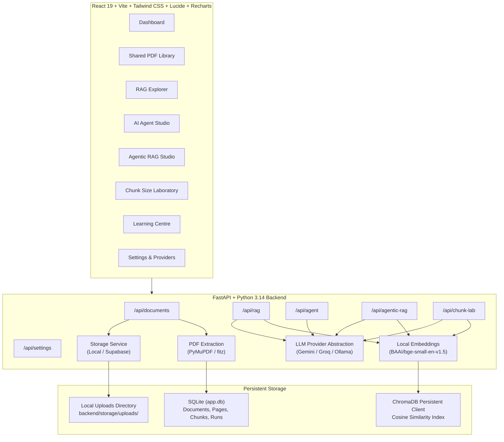

# AI Learning Lab – Architectural Reference

## 1. System Overview

**AI Learning Lab** is an interactive, full-stack educational web application designed for students and developers learning AI engineering. It demonstrates the technical and operational differences between:

1. **Conventional RAG**: Single-pass vector retrieval and prompt augmentation.
2. **AI Agents**: Multi-step ReAct loops (`THINK → ACT → OBSERVE`) with deterministic external tools.
3. **Agentic RAG**: Autonomous query decomposition, multi-document evidence collection, quality evaluation, and bounded retries.
4. **Chunk Size Comparison Laboratory**: Side-by-side benchmarking of 128 vs 256 vs 400 token chunk boundaries on the identical document and query.

---

## 2. Architecture Diagram



---

## 3. Core Modules & Engineering Details

### 3.1 Shared PDF Library
- **Extraction**: Page-by-page extraction preserving 1-indexed page references using `PyMuPDF`.
- **Validation**: File header inspection (`%PDF`), size limit (50MB), duplicate check via SHA-256 cryptographic hashing.
- **Preview**: High-speed rasterization of PDF pages to PNG pixmaps (`page.get_pixmap()`) rendered directly in the student preview modal.
- **Storage Abstraction**: Seamless `BaseStorageDriver` allowing instant switch from local filesystem to Supabase Storage private buckets.

### 3.2 Embedding & Tokenizer Alignment
- **Embedding Model**: `BAAI/bge-small-en-v1.5` running locally via HuggingFace SentenceTransformers (384 dimensions, cosine distance metric).
- **Tokenizer**: Uses `AutoTokenizer.from_pretrained('BAAI/bge-small-en-v1.5')` to count tokens when slicing text.
- **Sequence Safety**: Hard ceiling of 512 tokens enforced; silent truncation is completely prevented.

### 3.3 Conventional RAG Explorer
- Clickable 8-stage interactive pipeline:
  1. PDF Input
  2. Text Extraction
  3. Token-Bounded Chunking
  4. Numerical Embeddings (384d coordinate inspection)
  5. ChromaDB Vector Store
  6. Cosine Similarity Retrieval
  7. Prompt Augmentation Inspection
  8. Grounded LLM Response with Page Citations

### 3.4 AI Agent Studio
- Implements the canonical cognitive loop:
  `THINK → ACT → OBSERVE → THINK AGAIN → FINAL ANSWER`.
- 5 Working Deterministic Tools:
  1. **Safe Calculator**: Evaluates arithmetic expressions and percentages using AST parsing (no arbitrary code execution).
  2. **Date Calculator**: Date intervals, working days, calendar offsets, and deadline countdowns.
  3. **Mock Travel Search**: Simulated travel options, lodging, and daily meal budgets.
  4. **Text Analysis**: Word counts, key phrase extraction, and extractive bullet summaries.
  5. **Simple Data Analysis**: Aggregation, averages, min/max on tabular CSV records.
- Safety Bounds: Maximum 10 steps, tool validation, and stop hooks.

### 3.5 Agentic RAG Studio
- Solves multi-part inquiries across multiple document versions (e.g. Nexora 2024 vs 2025 handbooks).
- Agent decomposes question into sub-tasks for specific documents.
- Evaluates retrieval quality: checks whether retrieved chunks contain required numbers and policy terms.
- Query rewriting: rewrites search terms targeting summary schedules if initial retrieval is insufficient.
- Synthesizes findings into a comprehensive comparison table with citations.

### 3.6 Chunk Size Comparison Laboratory
- Controls all variables except chunk size: identical PDF, identical question, identical embedding model, identical LLM, identical Top K.
- Benchmarks 3 configurations side-by-side (e.g., 128 vs 256 vs 400 tokens).
- Measures actual metrics:
  - Total chunks generated
  - Context tokens sent in prompt
  - Retrieval latency (ms)
  - Peak similarity score
  - Side-by-side AI answers
- Highlights query terms in retrieved chunks.
- Educational synthesis explaining precision vs context trade-offs.
- Visual charts rendered with Recharts and 1-click CSV/JSON export.

---

## 4. Cloud Deployment Strategy

### Frontend
- Host static build (`npm run build`) on Vercel, Netlify, or Cloudflare Pages.
- Environment variables: `VITE_API_BASE_URL` pointing to the deployed backend URL.

### Backend
- Deploy FastAPI container to Render, Railway, or Fly.io.
- Python 3.11 - 3.14 compatible.
- Startup command:
  ```bash
  uvicorn backend.app.main:app --host 0.0.0.0 --port $PORT
  ```

### Database & Storage Migration
- Set `STORAGE_TYPE=supabase` in environment variables.
- Configure `SUPABASE_URL`, `SUPABASE_KEY`, and `SUPABASE_BUCKET`.
- Documents and metadata store in Supabase PostgreSQL, while PDF binaries store in Supabase Storage.

